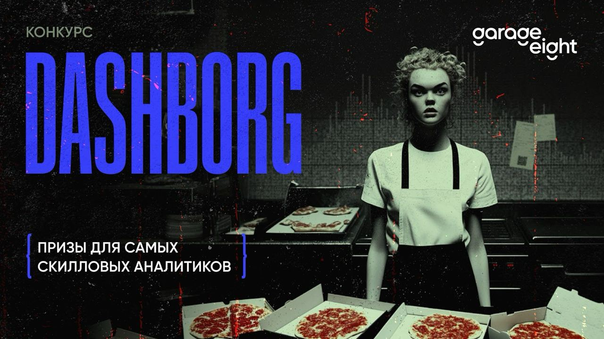
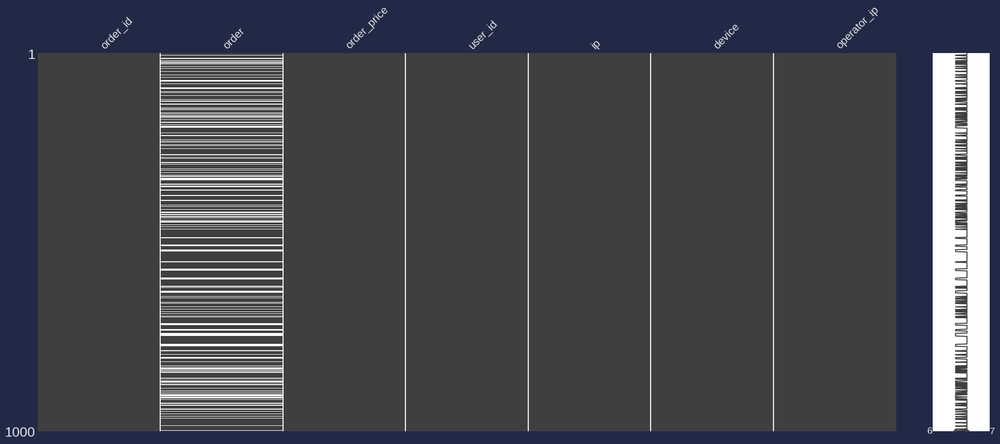
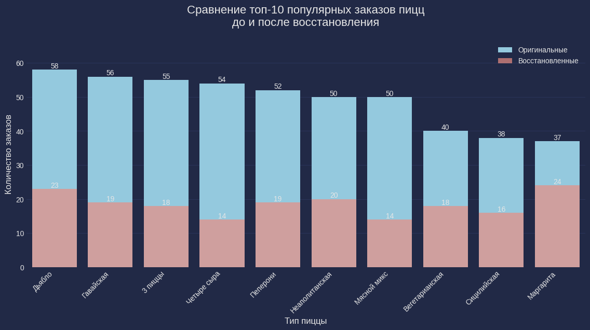
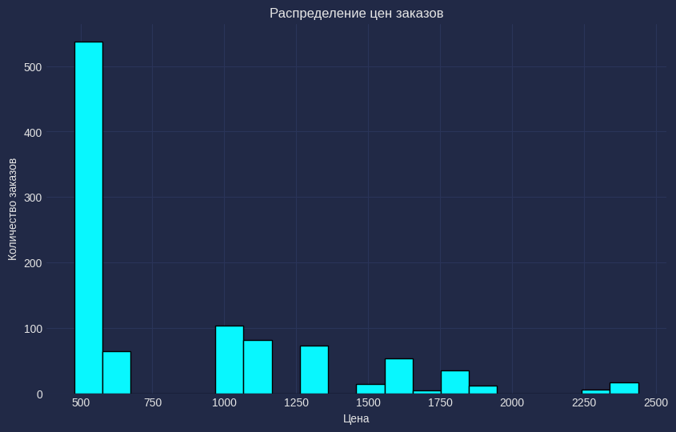
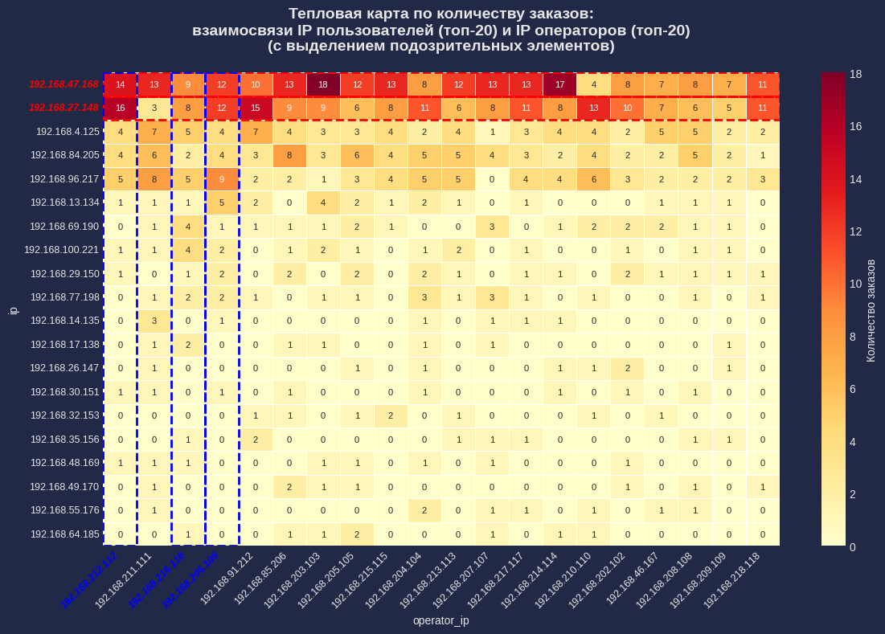
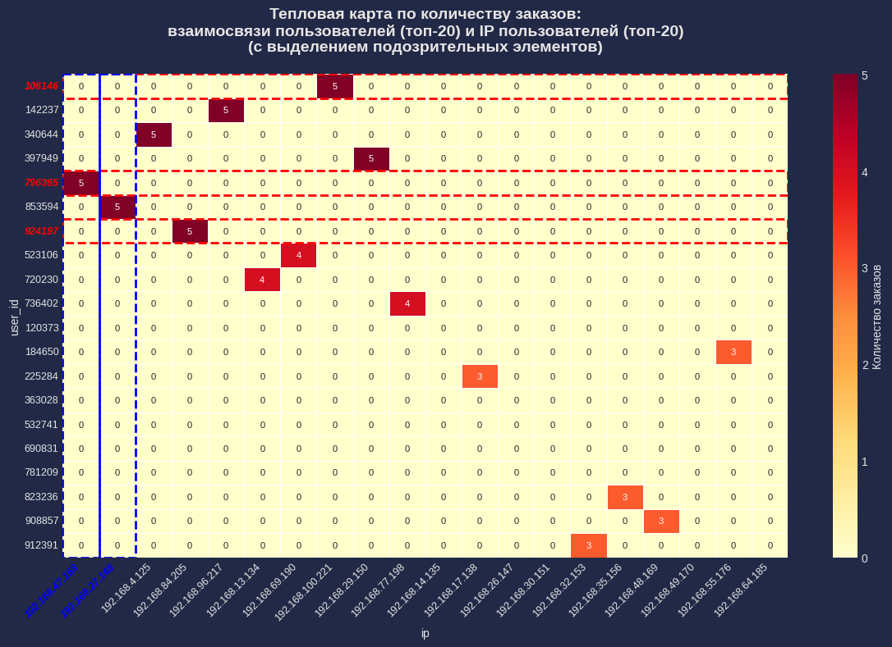
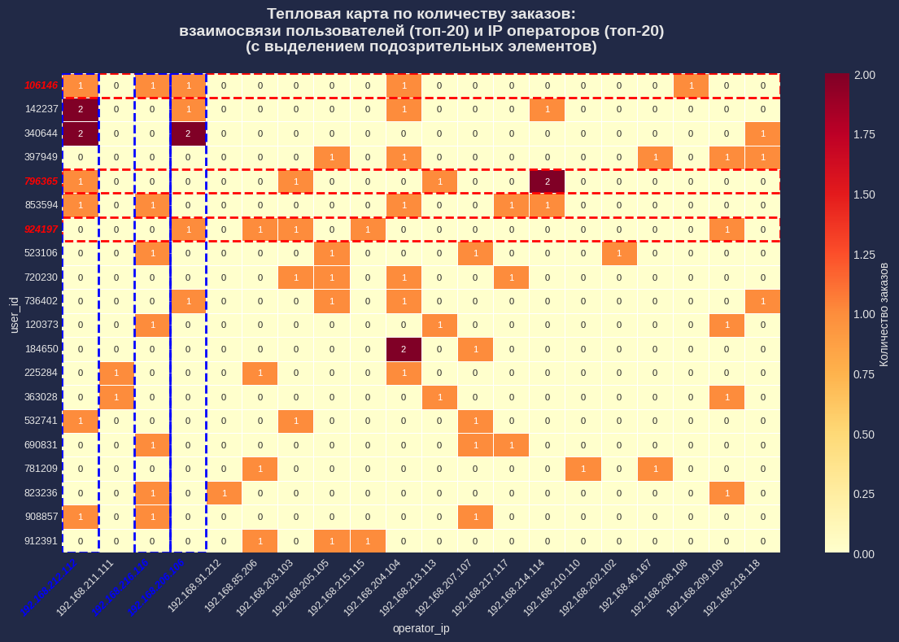
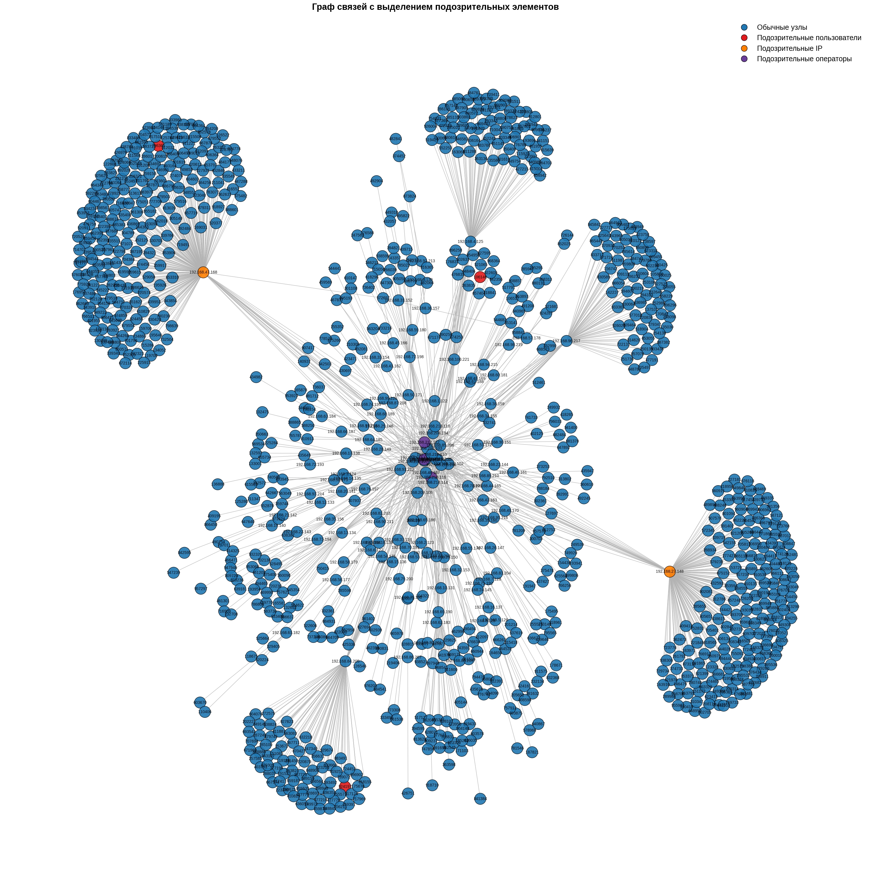
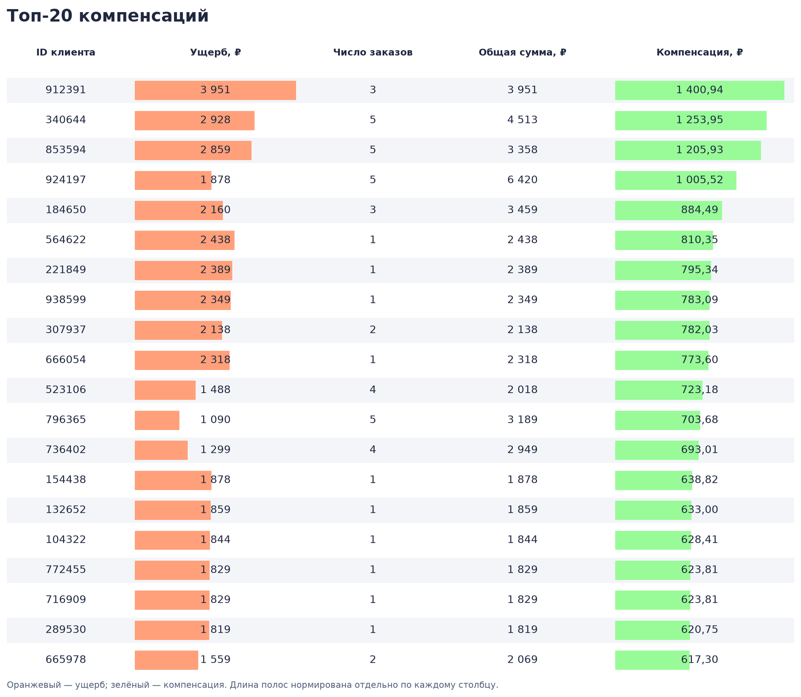

# Data Challenge - Кейс DASHBORG - восстановление данных и поиск аномалий

> **В этом репозитории опубликовано моё решение кейса DASHBORG, с которым я заняла призовое место в аналитическом конкурсе от компании Garage Eight.**

[](https://t.me/garage_eight/1444)

## Контекст и условия конкурса

**DASHBORG** — конкурсный кейс о сервисе доставки пиццы в вымышленном городе Дашборг. По условиям кейса в результате несанкционированного вмешательства в систему была утрачена часть данных о заказах, что привело к сбоям в доставке и ущербу для клиентов.

Участникам предоставили две таблицы: заказы с частично утраченным составом и сведения о пользователях, их IP-адресах, типах устройств и IP-адресах операторов, обрабатывавших заказы. Стоимость заказов сохранилась — её можно было использовать для восстановления пропущенных позиций меню.

Требовалось решить три задачи и обосновать полученные результаты:

1. **Восстановить данные:** определить состав заказов, в которых названия заказанных пицц были потеряны.
2. **Исследовать инцидент:** найти возможных злоумышленников по активности пользователей и связям между пользователями, IP-адресами и операторами.
3. **Рассчитать компенсации:** предложить способ распределения фонда **90 000 ₽** между пострадавшими клиентами.

В моём решении восстановление по ценам и истории заказов сочетается с исследовательским анализом, визуализацией связей и поиском аномалий с помощью Isolation Forest. В репозитории собраны полный ход исследования, графики и итоговые таблицы.

**[Исследование в Jupyter Notebook](notebooks/dashborg_analysis.ipynb)** · **[Результаты в CSV](results/)** · **[Пост организаторов](https://t.me/garage_eight/1444)**

## Основные результаты

| Направление | Результат |
| :--- | :--- |
| Качество исходных данных | В 269 из 1 000 заказов отсутствовал состав — 26,9% записей |
| Восстановление | Заполнены все 269 пропусков; в сохранённом исследовании цены всех 1 000 заказов совпали с расчётными |
| Поиск аномалий | Выделены подозрительные пользователи, IP-адреса и операторы; сопоставлены результаты анализа связей и Isolation Forest |
| Компенсации | Рассчитаны выплаты для 258 клиентов при оценке ущерба в 225 598 ₽ |
| Покрытие ущерба | Около 39,89%; сумма выплат после округления — 90 000,04 ₽ |

Заполнение пропусков и совпадение цен проверяют полноту и согласованность результата. Они не гарантируют, что при нескольких допустимых составах выбран именно исходный заказ.

## Данные

Два набора данных организаторов содержат по 1 000 строк:

| Набор | Поля | Назначение |
| :--- | :--- | :--- |
| Заказы | `order_id`, `order`, `order_price`, `user_id` | Восстановление состава и расчёт ущерба |
| Устройства и адреса | `ip`, `device`, `operator_ip`, `user_id` | Анализ активности и связей |

В ноутбуке таблицы объединены по порядку строк с явной проверкой совпадения `user_id`. Проверены полные дубликаты и повторения `order_id`: в сохранённом запуске их не обнаружено.

Исходные таблицы загружаются из Google Sheets по ссылке в ноутбуке. В репозитории находятся итоговые CSV.



*Белые полосы в столбце `order` показывают потерянные составы заказов. Остальные поля заполнены и используются для восстановления и анализа.*

## Подход и выводы

### 1. Восстановление состава заказов

Для каждой позиции меню рассчитана медианная цена по заполненным заказам с одной позицией. Затем для пропущенного состава подбираются комбинации до трёх различных позиций, соответствующие цене заказа.

При нескольких допустимых вариантах используются:

1. История заказов конкретного пользователя.
2. Частоты составов заказов с такой же ценой — для случайного выбора с весами.
3. Первый допустимый вариант, если подходящей истории нет.

После восстановления проверены соответствие цен, состав комбинаций и распределение популярных заказов.



*График из конкурсного ноутбука: частоты топ-10 составов среди исходно заполненных заказов и среди восстановленных записей. Размеры этих групп различаются.*

### 2. Поиск аномалий и анализ связей

Исследованы количество и стоимость заказов, доля пропущенных составов, типы устройств, концентрация активности по IP и пересечения пользователей с операторами.



*Большинство заказов сосредоточено в диапазоне 500–600 ₽. Более высокие чеки сопоставлены с ценами позиций и составами заказов.*

Два IP-адреса заметно выделяются по числу заказов: `192.168.47.168` — **222**, `192.168.27.148` — **182**. Тепловые карты помогают проверить, как эта активность распределена между операторами.



*Число заказов на пересечении IP пользователя и IP оператора. Выделены адреса, выбранные для дополнительной проверки.*

**Связи пользователей с IP-адресами**



*Карта показывает, с каких IP оформляли заказы наиболее активные пользователи. Выделены пользователи и адреса, отобранные для дополнительной проверки.*

**Связи пользователей с операторами**



*Заказы выбранных пользователей распределены между несколькими операторами. Карта позволяет сопоставить эти пересечения с результатами анализа IP-адресов.*

Для анализа общей структуры построен граф **пользователь → IP пользователя → IP оператора**.

<a href="docs/images/connections-graph.png"></a>

*Полный граф из ноутбука. Нажмите на изображение, чтобы рассмотреть связи в исходном разрешении.*

Дополнительно обучены две модели **Isolation Forest**: для профилей пользователей и операторов. Признаки включают число заказов, средний и максимальный чек, общий объём заказов и разнообразие устройств; для операторов также учитывается число уникальных пользователей.

В конкурсном выводе приоритетной для проверки стала связь пользователя **`796365`**, IP **`192.168.47.168`** и оператора **`192.168.212.112`**. Пользователи `106146` и `924197` также выделены по совокупности факторов. Все три пользователя вошли в список аномалий Isolation Forest.

Общий IP, смена устройств и метка модели дают основания для проверки, но не доказывают причастность к инциденту. В данных нет временных меток, а `unknown` встречается и у других клиентов.

### 3. Распределение компенсаций

Ущербом в рамках решения считается сумма заказов с изначально потерянным составом. Компенсацию получают только пользователи с положительным ущербом.

| Фактор | Как рассчитывается | Вес |
| :--- | :--- | ---: |
| Ущерб | Сумма заказов с потерянным составом | 70% |
| Лояльность | Количество заказов клиента | 20% |
| Объём заказов | Общая стоимость заказов клиента | 10% |

Каждый фактор нормируется на максимальное значение среди пострадавших клиентов. Фонд распределяется пропорционально взвешенной сумме:

$$
s_i = 0.7\frac{d_i}{\max_j d_j} + 0.2\frac{n_i}{\max_j n_j} + 0.1\frac{v_i}{\max_j v_j},
\qquad c_i = 90\,000\frac{s_i}{\sum_j s_j}.
$$

В [итоговой таблице](results/users_compensation.csv) указаны ущерб, число заказов, общий объём и компенсация для каждого клиента. Веса — выбранное правило распределения, которое можно изменить под бизнес-приоритеты.



*Оранжевые полосы показывают размер ущерба, зелёные — размер компенсации. Длина полос нормирована отдельно внутри каждого столбца.*

После округления каждой выплаты до копеек итог составляет **90 000,04 ₽**. CSV сохранён в конкурсном виде.

## Структура репозитория

```text
.
├── notebooks/
│   └── dashborg_analysis.ipynb     # Исследование с сохранёнными выводами и графиками
├── results/
│   ├── restored_orders.csv        # 1 000 заказов с заполненным составом
│   └── users_compensation.csv     # Компенсации для 258 клиентов
├── docs/
│   ├── images/                    # Афиша и графики из ноутбука
│   └── contest/announcement.txt   # Предоставленный текст анонса со ссылкой
├── .gitattributes
├── .gitignore
├── requirements.txt
└── README.md
```

## Как посмотреть и запустить

Для знакомства с работой достаточно открыть [ноутбук](notebooks/dashborg_analysis.ipynb) на GitHub: таблицы, графики и выводы уже сохранены.

Для повторного запуска рекомендуется **Python 3.11**. Из корня репозитория:

```bash
python -m venv .venv
```

Активируйте окружение:

```powershell
# Windows PowerShell
.\.venv\Scripts\Activate.ps1
```

```bash
# macOS / Linux
source .venv/bin/activate
```

Установите зависимости и откройте ноутбук:

```bash
python -m pip install -r requirements.txt
python -m jupyterlab notebooks/dashborg_analysis.ipynb
```

Для загрузки исходных данных нужен доступ к Google Sheets организаторов. Локальные пути экспорта адаптированы: повторный запуск сохраняет CSV в `results/rerun/`.

**Особенности воспроизводимости:**

- В ноутбуке сохранены результаты конкурсного запуска; случайный выбор состава заказа и раскладка графа не имеют фиксированного seed и могут различаться при повторном выполнении.
- Isolation Forest использует `random_state=42`; доли аномалий заданы параметрами `contamination=0.01` для пользователей и `0.3` для операторов. Размеченных данных для оценки качества детекции нет.
- `requirements.txt` задаёт диапазоны совместимости, а не точную копию исходного окружения.

## Инструменты

**Python · pandas · NumPy · scikit-learn · NetworkX · Matplotlib · seaborn · missingno · Jupyter**

## Источник материалов

Условия и иллюстрация конкурса — **Garage Eight**. [Оригинальный анонс в Telegram](https://t.me/garage_eight/1444). Исследование, выводы и итоговые таблицы представлены в этом репозитории; права на материалы организаторов принадлежат их правообладателям.
